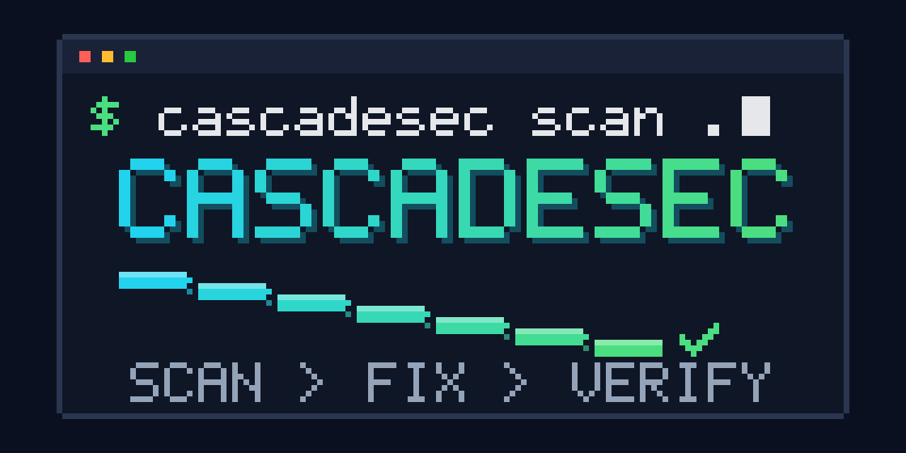
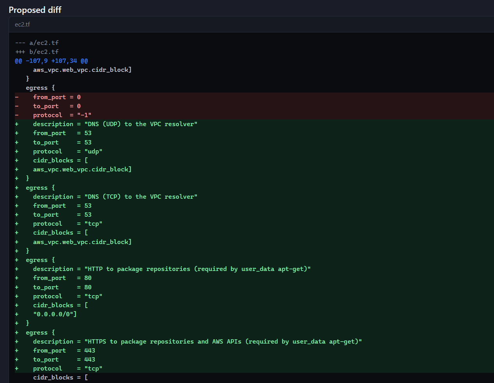
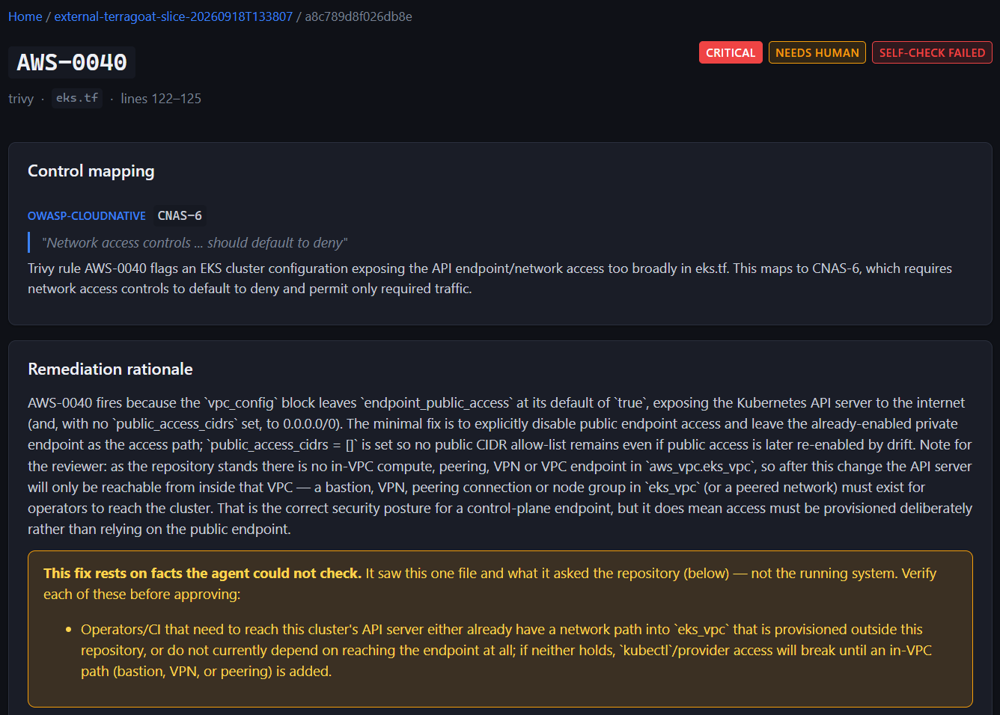
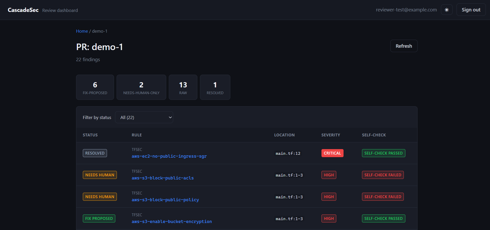

# CascadeSec

**Infrastructure-as-code security scanning with AI-drafted fixes that have to prove themselves before they are suggested. Runs on serverless AWS and inside the GitHub pull request.**


Established open-source scanners find the misconfiguration. An AI agent drafts the fix, and the fix is only suggested to a reviewer after the same scanners confirm it actually solves the problem. A maintainer can then commit the verified fixes to the pull request with one click.

**See it working:** [a pull request on the test repository](https://github.com/konradkelly/cascadesec-testbed/pull/2). It shows the CascadeSec check run with 44 annotations, six fixes posted as suggested changes, and two commits made by the CascadeSec Fixes App after the fixes were approved.

## Highlights

- **AI that has to prove its work.** Detection is deterministic (Trivy, Checkov, KICS and custom Rego checks), so the model cannot invent a finding. A drafted fix is suggested to a reviewer only once a rescan shows it clears the finding without adding a new one and without suppressing the scanner. Any other fix, or one that depends on something the agent could not check, is held for a human with the reason spelled out.
- **Measured, with the method published.** **98.9%** detection recall on 90 labelled cases. **85.1%** of findings were mapped to the right compliance control (OWASP, CIS, NIST 800-53) in a blind measurement, and every miss was traced to the rule-to-control table, which has since been corrected. [Method and limits](./corpus/eval/README.md). Fix quality is the next measurement.
- **Untrusted code runs in a sandbox.** AWS CDK apps from a pull request are synthesized on Fargate with no IAM role and no route to the internet, behind a DNS firewall, so the code being scanned holds no credentials.
- **Run with production habits.** 18 AWS services, all in Terraform, deployed through a guard written after a bad apply took a component down, and checked against `main` by a drift check. Two GitHub Apps split the permissions: one reports on the pull request, and only the other can push commits. 1,677 tests run in CI, none with AWS credentials.
- **Seven IaC languages in pull requests:** Terraform, OpenTofu, Kubernetes, CloudFormation, Azure ARM, Bicep and AWS CDK. A CLI also scans locally, runs as a pre-commit hook, and writes SARIF for GitHub Code Scanning.



*A fix the agent proposed for a security group in [terragoat](https://github.com/bridgecrewio/terragoat), code nobody on this project wrote. The `0.0.0.0/0, all ports` egress is replaced by four scoped rules. The agent read the instance's `user_data` and found the `apt-get` that needs ports 80 and 443.*

## Try it in two minutes

You need Python 3.11 or later, [pipx](https://pipx.pypa.io/), git and Docker. No account or API key: a local scan runs the published scanner image with networking turned off.

```bash
pipx install "git+https://github.com/konradkelly/CascadeSec#subdirectory=cli"
git clone --depth 1 https://github.com/bridgecrewio/terragoat
cascadesec scan terragoat/terraform/aws
```

The first run downloads the scanner image (about 350 MB). Tested on 2026-11-09 with a fresh install on Windows and Linux: on terragoat's AWS code it found 333 issues in 14 files in about 15 seconds, and listed for most of them the compliance controls a full scan would choose among. It exits with code 1 when it finds anything rated high or above, as a CI gate would. A local scan is detection only: control citations and AI-drafted fixes come from the deployed pipeline. More in the [CLI guide](./cli/README.md).

## How it works

**The design principle: the agent proposes, it never decides.**

1. **Detect.** Trivy, Checkov, KICS and the project's own Rego checks find the issue. Detection is deterministic, so the model cannot hallucinate a finding.
2. **Map.** An LLM agent maps each finding to the control it violates, with a citation. It can only choose among candidates that a curated rule-to-control table allows.
3. **Fix and self-check.** A second agent drafts a minimal diff, then re-scans its own fix. A fix that doesn't clear the finding, introduces a new one, or suppresses the scanner instead of fixing anything is never shown to a human as a suggestion.
4. **Ask instead of assume.** When a fix depends on the rest of the repository, the agent asks a context agent, and every answer is cited to `file:line`.
5. **A human decides.** Every fix is reviewed and committed by a person, either in the dashboard or on GitHub. Nothing is auto-merged.

### Why

Most "AI security scanner" tools ask an LLM to find and judge issues in one pass, with no way to check the model's claims. CascadeSec keeps detection deterministic and checks every LLM-drafted fix against the same scanner that found the problem. A proposed fix is never just the model's word that it worked.

## In a pull request

1. A push to a PR triggers a scan through the **CascadeSec GitHub App**. The PR gets a check run with annotations on the lines it adds.
2. **Draft fixes** on the check runs remediation. Self-checked fixes inside the PR's diff are posted as suggested changes.
3. The check then shows every verified fix as a diff, with a **Commit fixes** button for anyone with write access. A second App, **CascadeSec Fixes**, commits them to the branch as one signed commit. It writes only over the file versions the fixes were drafted on, and refuses a click on an outdated check.
4. That commit is scanned like any other push, which verifies each fix on the real branch.

The same commit can be requested from the review dashboard by members of a `committers` Cognito group.

## Screenshots

A finding the agent would *not* propose a fix for. The self-check failed and the fix rested on something the agent could only assume about the repository, so it is held for a human with the assumption spelled out.



The review queue for one scan. Every finding carries its status, the rule that raised it, and whether the proposed fix survived the self-check.



## Architecture

```
GitHub PR / scripts/scan.py
        │
        ▼
webhook-receiver (Lambda) ──▶ Step Functions (one execution per PR push)
                                      │
                                      ▼
                         iac-scanner (Lambda, container image)
                         Trivy + Checkov + KICS + IACP-* checks
                                      │
                                      ▼
                             mapping-agent (Lambda)
                     finding → OWASP/CIS/NIST control + citation
                                      │
                                      ▼
                    Map state: remediation-agent, one per file
                  proposes diff → self-checks against iac-scanner
                    ↳ context-agent: repo questions, cited to file:line
                                      │
                                      ▼
                     DynamoDB ──▶ github-gateway (Lambda)
                                  check run, annotations, suggestions
                                      │
              Commit fixes click / dashboard request (committers group)
                                      │
                                      ▼
            commit state machine → github-committer (Lambda, writer App)
                         one signed commit on the PR branch

API Gateway (Cognito JWT) → review-api (Lambda) → dashboard (React + Vite + TS, CloudFront + S3)
```

Lambda, Step Functions, API Gateway, DynamoDB, S3, ECR, Cognito, CloudFront, Secrets Manager, KMS (the GitHub Apps' signing keys), EventBridge, CloudWatch (EMF metrics, alarms), X-Ray and SNS, all provisioned in Terraform. Built partly as hands-on practice for AWS Developer Associate (DVA-C02).

Full technical spec (data model, agent JSON contracts, eval plan, build phases): [`iacposture-spec.md`](./iacposture-spec.md). Per-feature specs are in [`docs/`](./docs/).

## Evaluation

Every number below is measured against the **deployed** pipeline, with the method, dates and corrections in [`corpus/eval/README.md`](./corpus/eval/README.md).

- **Detection: 98.9%**, 178 of 180 expected findings across 84 labelled vulnerable cases and 6 clean controls, which raised nothing (2026-11-01). Both misses are documented gaps in the upstream tools, left as misses rather than relabelled. This mostly measures the scanners.
- **Control mapping: 85.1%**, 154 of 181 findings mapped to a right control, the same in three runs, measured blind against labels reviewed before any number was computed (2026-11-01). Every miss came from the rule-to-control table offering no right control, not from the agent choosing badly. The table was corrected and deployed, and all 181 now map right (2026-11-03). That shows the gaps are closed, not a second measurement, since the same labels drove the correction. 99.4-99.7% of the agent's citations are faithful quotations of the control.
- **Fix quality: not measured yet.** A clean rescan proves a finding is gone, not that the infrastructure still works. The next step is a fix-quality eval with a human audit of the fixes ([`docs/completion.md`](./docs/completion.md), phase 2).

## Limitations

- **Fix quality is unmeasured** (above). Comparable published work, [TerraRepair](https://drops.dagstuhl.de/entities/document/10.4230/LIPIcs.ESEM.2026.68), found about one in five scanner-verified fixes wrong on human review.
- **The agents run only on AWS today.** Running them without an AWS account is in progress; local scanning already works without one.
- **Drafts vary from run to run**, so the same finding can get a different fix.
- **Remediation rewrites whole files**, which makes fixes in very large files slow and expensive.
- **Pulumi and Helm are detection only**, run by hand, and OpenTofu has a single scanner (Trivy).
- **The project has not been security-audited.**

What is left before 1.0, and what is deliberately out of scope, is in [`docs/completion.md`](./docs/completion.md).

## Status

**Deployed and running** against a dev AWS account, with the GitHub Apps installed on the [test repository](https://github.com/konradkelly/cascadesec-testbed). CI runs 1,677 tests on every push, with no AWS credentials, so a test run can never touch real infrastructure.

| Version | What | State |
|---|---|---|
| v1 | Terraform scanning, control mapping, self-verified remediation, review dashboard | Deployed |
| v2 | Kubernetes manifests, CloudFormation, Azure ARM and Bicep (CIS Azure 3.0) | Deployed ([spec](docs/multi-iac-spec.md)) |
| v3 | GitHub App: PR check runs, annotations, Draft fixes as suggested changes | Deployed 2026-09-25 ([spec](docs/ci-integration-spec.md)) |
| v4 | Write-back: verified fixes committed to the PR branch from the dashboard or a **Commit fixes** button on the check | Deployed and verified live 2026-09-30 ([write-back](docs/write-back-spec.md), [GitHub-first review](docs/github-first-review-spec.md)) |
| Sandbox | CDK apps synthesized with no credentials, findings placed on the TypeScript line, fixes verified by synthesizing again | Deployed 2026-10-11 ([spec](docs/sandbox-spec.md)) |
| Sandbox, by hand | Pulumi programs (TypeScript and JavaScript, 13 AWS resource types) and Helm charts, detection only | Run on AWS by 2026-10-13 |
| CLI | Local scan with a baseline, pre-commit hooks, SARIF, and review commands | Merged by 2026-10-31; images public on GHCR since 2026-11-01 ([CLI](docs/cli-spec.md), [SARIF](docs/sarif-spec.md)) |
| Portable runtime | The agents without AWS: one core, local stores, `cascadesec run` | In progress ([spec](docs/portable-runtime-spec.md)) |

## Running the pipeline on AWS

The pipeline is a Terraform stack ([`terraform/`](./terraform/)) deployed through `scripts/deploy.py`. Deploying your own copy needs an AWS account, an Anthropic API key and two registered GitHub Apps, and is not yet packaged as a one-step install. Against a deployed stack, with AWS credentials and `terraform` on `PATH`:

```bash
python scripts/scan.py path/to/terraform          # upload, scan, map, then ask before remediating
python scripts/scan.py path/to/terraform --yes    # don't ask
python corpus/eval/run_eval.py                    # detection recall over the labelled cases
python corpus/external/run_external.py           # scan pinned third-party repos, compare to baseline
```

`scan.py` uploads the directory, starts one execution of the pipeline, reports each stage as it runs, and prints the dashboard URL when it finishes. Remediation costs one model call per mapped finding, so `scan.py` asks before running it (`--no-remediate` stops after mapping). Against a deployed stack the CLI also reads, decides on and commits fixes from the terminal.

Helm charts can be rendered offline in the sandbox and their manifests scanned with `python scripts/sandbox.py helm path/to/repo --app-dir charts/app --scan`, detection only ([sandbox spec](docs/sandbox-spec.md)).

## Tech stack

- **Infra:** AWS Lambda (zip and container image), Step Functions, API Gateway, DynamoDB, S3, ECR, Cognito, CloudFront, Secrets Manager, KMS, EventBridge, CloudWatch, X-Ray, SNS, all in Terraform
- **Sandbox:** ECS on Fargate with no task role, a VPC with endpoints and no route out, CodeArtifact as the only package mirror, Route 53 Resolver DNS Firewall
- **CLI:** Python, the OS keyring for sessions, the pinned scanner image under Docker, pre-commit, SARIF
- **GitHub:** two GitHub Apps (a reader and a writer). They use webhooks, the Checks API (annotations and action buttons), PR reviews with suggested changes, and signed commits through the Git Data API
- **Scanning:** Trivy, Checkov, KICS, and custom Trivy checks in Rego
- **Agents:** Anthropic API, with outputs constrained to strict JSON schemas
- **Frontend:** React, Vite, TypeScript
- **CI:** GitHub Actions: pytest per Lambda, the CLI on Linux and Windows, corpus data tests, the deploy guard, Node and Helm harnesses for the sandbox, and oxlint, `tsc` and Vitest for the dashboard

## Disclaimer

This is an educational/portfolio project built to explore agentic AppSec/DevSecOps tooling patterns. It has not been security-audited and is not intended for production use scanning or remediating real infrastructure without independent review.

## License

MIT
